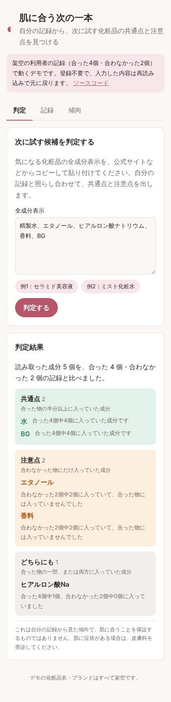
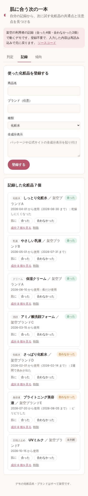
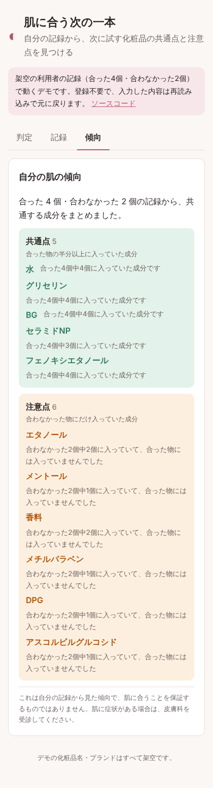

# 肌に合う次の一本（skin-match）

**日本語** | [English](README.en.md)

[](https://github.com/cedarcraftworks/skin-match/actions/workflows/ci.yml)
[](https://cedarcraftworks.github.io/skin-match/)

自分が「肌に合った／合わなかった」と記録した化粧品の全成分をもとに、**次に試す候補の共通点と注意点を、根拠付きで示す**Webアプリです。

**[▶ デモを開く](https://cedarcraftworks.github.io/skin-match/)**（登録不要。架空の利用者の記録で動きます）

| 判定 | 記録 | 傾向 |
| --- | --- | --- |
|  |  |  |

## 解決したい課題

自分の肌に合う化粧品を見つけるまでに、何度も失敗していました。合った物が廃番になったり、化粧水は合っても乳液を選ぶときに手がかりがなかったりして、毎回一から試すことになります。全成分表示を見ても、自分に合うかどうかは判断できません。

## このアプリでできること

1. 使った化粧品を、全成分表示と一緒に「合った／合わなかった」で記録する
2. 気になる候補の全成分を貼り付けると、自分の記録と照らし合わせて次の4つに分ける
   - **共通点**：合った物の半分以上に入っていた成分（例：「合った4個中4個に入っていた成分です」）
   - **注意点**：合わなかった物にだけ入っていた成分
   - **どちらにも**：合った物の一部、または両方に入っていた成分
   - **情報なし**：まだ試したことのない成分
3. 記録全体から、自分の肌の傾向（合った物に多い成分、合わなかった物だけの成分）を見る

「精製水」と「水」、「ヒアルロン酸ナトリウム」と「ヒアルロン酸Na」のような書き方の違いは、[表記ゆれ辞書](contract/ingredient-aliases.json)で統一してから数えます。

## 設計で大事にしたこと

- **AIで肌を診断しない**：個人では正解データを集められず、精度を示せないためです。代わりに、本人の記録を数えた事実だけを根拠として見せます。
- **断定しない**：「肌に合う」「〇〇が原因」とは表示せず、「合わなかった2個中2個に入っていた」と事実を示します。判定画面には常に注意書きを出します。
- **同じ入力なら必ず同じ結果**：判定は数えるだけの単純な規則にして、[共通テストケース](contract/cases.json)で結果を固定しています。
- **健康に関わる記録は本人だけ**：すべての操作で「そのデータの持ち主か」を確認し、他人の記録は存在するかどうかも返しません。

既存サービスとの違い：避ける成分を探すアプリ（ポーテなど）や、英語・海外の商品中心の成分比較サイト（Skinsort など）、AI肌診断とは違い、**自分に合った物を基準に、日本の商品の次の候補を判断する**ことに絞っています。

## 構成

```
画面（TypeScript / React）──JSON──▶ API（Java / Spring Boot）──SQL──▶ PostgreSQL
                                          │
                                          ▼ 成分と記録を渡す
                                判定（Python / FastAPI）
```

| 部分 | 技術 | 役割 |
| --- | --- | --- |
| [web/](web) | TypeScript、React、esbuild | 記録・判定・傾向の画面。デモ版は判定もブラウザ内で行う |
| [api/](api) | Java 21、Spring Boot 3、Flyway | ログイン、化粧品と使用記録の保存、本人の記録を集めて判定サービスへ渡す |
| [analyzer/](analyzer) | Python 3.12、FastAPI | 成分表示の整理（表記ゆれの統一）と、共通点・注意点の判定 |
| [contract/](contract) | JSON | 表記ゆれ辞書と、Python と TypeScript が同じ結果を返すことを確かめる共通テスト |

**なぜ3つの言語に分けたか**：ログインと保存は堅さが大事なので Java、文字の整理と集計は Python が書きやすく、画面は型で入力ミスを防げる TypeScript を選びました。判定の規則は Python と TypeScript の両方にあり、[contract/cases.json](contract/cases.json) の同じケースを両方のテストで通すことで、2つがずれないようにしています。

## 動かし方

```bash
# デモ版の画面だけ（サーバー不要）
cd web && npm install && npm run dev   # http://localhost:5173

# 全体（PostgreSQL・判定サービス・API）
docker compose up --build
cd web && npm install && API_URL=http://localhost:8080 npm run dev:api   # http://localhost:5173
```

## テスト

| 対象 | コマンド | 内容 |
| --- | --- | --- |
| Python | `cd analyzer && pytest` | 共通ケース、API の入出力、不正な入力 |
| Java | `cd api && mvn verify`（PostgreSQL が必要） | 登録・ログイン・ログアウト、他人のデータに触れられないこと、判定に本人の記録だけが渡ること |
| TypeScript | `cd web && npm test && npm run typecheck` | 共通ケース、デモのデータでの判定 |

すべて GitHub Actions で、変更のたびに自動で実行しています。

## 今後追加すること

- 肌の写真を同じ条件で撮影し、使用前後を並べて比べる機能
- 全成分表示の順番（配合量の多い順）を使った判定
- 商品パッケージの写真からの成分の読み取り

## 注意

このアプリは自分の記録から傾向を示すもので、肌に合うことを保証するものではありません。肌に症状がある場合は皮膚科を受診してください。デモの化粧品名・ブランドはすべて架空です。

## ライセンス

[MIT](LICENSE)
